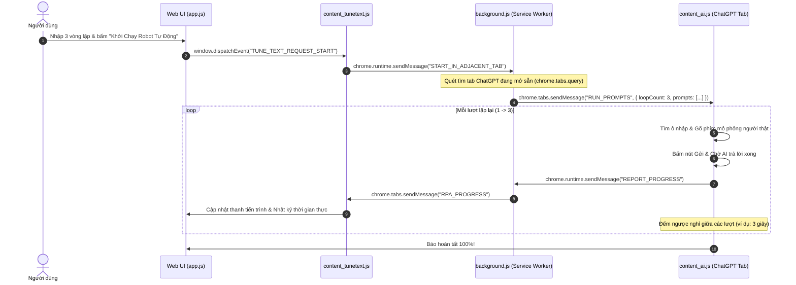

# Đặc Tả Kiến Trúc Tiện Ích Chrome Extension (Chrome Extension Architecture)

Tài liệu này đặc tả thiết kế, luồng dữ liệu và cơ chế vận hành của tiện ích **Tune-Text AI Prompter (Chạy Tab Bên Cạnh)** nằm tại thư mục `chrome_extension/`.

---

## 1. Mục Đích & Bối Cảnh (Context & Purpose)

Người dùng thường đã đăng nhập sẵn tài khoản cá nhân (Google, ChatGPT Plus, Claude Pro...) trên trình duyệt Chrome thật của mình.
- **Vấn đề**: Việc mở cửa sổ tự động hóa mới (qua Selenium/Playwright) thường yêu cầu đăng nhập lại, dễ dính Cloudflare Turnstile bot-detection, và làm giật màn hình khi người dùng muốn vừa làm việc trên tab khác (Messenger, YouTube...) vừa để robot tự gõ.
- **Giải pháp**: Xây dựng một Chrome Extension chuẩn **Manifest V3** cài trực tiếp vào Chrome thật của người dùng. Robot sẽ tìm tab ChatGPT đang mở sẵn bên cạnh và tự động gõ văn bản vào đó hoàn toàn ngầm.

---

## 2. Cấu Trúc Thành Phần (Components)

```text
📂 chrome_extension
 ┣ 📜 manifest.json         # Khai báo quyền (tabs, storage, scripting) & host permissions
 ┣ 📜 background.js         # Service Worker điều phối, tìm tab AI và gửi lệnh chạy
 ┣ 📜 content_tunetext.js   # Content script nhúng vào trang localhost:8000
 ┣ 📜 content_ai.js         # Content script nhúng vào tab AI (ChatGPT, Claude, Gemini...)
 ┗ 📜 styles.css            # CSS giao diện HUD nổi hiển thị tiến độ trên tab AI
```

---

## 3. Luồng Giao Tiếp Dữ Liệu (Message Flow)



---

## 4. Các Tính Năng Kỹ Thuật Đã Tối Ưu (Key Technical Implementations)

1. **Hỗ trợ 100% Chạy Ngầm (Background Tab Support)**:
   - Các trình duyệt hiện đại (Chrome 120+) sẽ throttle (hạ ưu tiên) các tab ngầm, khiến `document.hasFocus()` trả về `false` và `offsetParent` bằng `null`.
   - Script tự động thích ứng: Sử dụng sự kiện `ClipboardEvent` / `DataTransfer` paste và `InputEvent` dự phòng để chèn văn bản vào ProseMirror của ChatGPT ngay cả khi tab không có focus.
2. **Cơ chế Khử Trùng Lặp & Tự Dọn Dẹp (Safe IIFE)**:
   - Toàn bộ `content_ai.js` được bọc trong closure `(() => { ... })()`.
   - Lưu trữ hook `window.__tuneTextStopPrevious` để dừng an toàn bất kỳ tiến trình cũ nào trước khi bắt đầu chu kỳ mới.
3. **Hiển Thị Tiến Độ HUD Nổi (Floating HUD)**:
   - Tạo hộp thoại nổi trong suốt hiện đại trên giao diện ChatGPT: Hiển thị rõ số lượt lặp lại (ví dụ: `Lượt 1/3 • Đoạn 1/1`), thanh tiến trình phần trăm và nút dừng khẩn cấp.
4. **Nút Làm Mới Tức Thì (1-Click Extension Reload)**:
   - Trên Web UI `localhost:8000`, có nút **"Nạp lại Extension"** kích hoạt sự kiện `TUNE_TEXT_RELOAD_EXTENSION` để gọi `chrome.runtime.reload()` mà không cần người dùng phải thao tác phức tạp.

