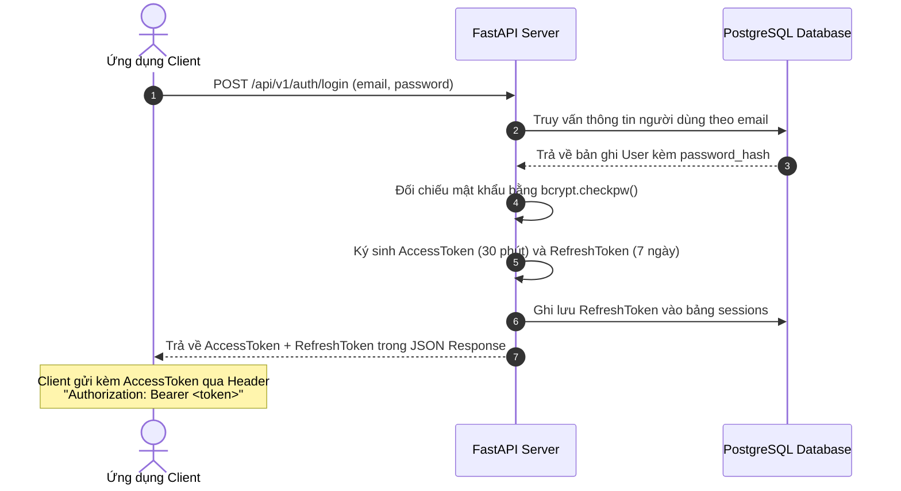

# Thiết kế Xác thực & Bảo mật (Authentication & Security Design)

Tài liệu này đặc tả các cơ chế xác thực danh tính, phân quyền RBAC và bảo vệ dữ liệu dành cho hệ thống Backend Python + PostgreSQL.

## 1. Cơ chế Xác thực Danh tính (Authentication with JWT)

Hệ thống áp dụng cơ chế xác thực Token phân tán kết hợp lưu trữ phiên làm việc bền vững:



### Chi tiết các Loại Token:
1. **AccessToken**:
   - Thời hạn: **30 phút** (`ACCESS_TOKEN_EXPIRE_MINUTES`).
   - Chứa thông tin payload: `sub` (User ID), `role` (Vai trò RBAC), `exp` (Thời gian hết hạn).
   - Được kiểm tra tính toàn vẹn chữ ký qua khóa bí mật `JWT_SECRET`.
2. **RefreshToken**:
   - Thời hạn: **7 ngày** (`REFRESH_TOKEN_EXPIRE_DAYS`).
   - Được lưu trực tiếp trong bảng `sessions` tại PostgreSQL để quản lý thu hồi (Revocation) khi người dùng đổi mật khẩu hoặc đăng xuất.

---

## 2. Phân quyền Người dùng theo Vai trò (RBAC)

Hệ thống phân cấp các vai trò người dùng thông qua bảng `roles`:
- **`ADMIN`**: Có quyền quản trị danh sách người dùng, xem toàn bộ dữ liệu hệ thống.
- **`USER`**: Có quyền tạo, xem, chỉnh sửa và xóa các tác vụ tinh chỉnh văn bản của chính mình.

### Middleware Kiểm tra Quyền (FastAPI Dependency):
```python
# Ví dụ áp dụng phân quyền tại Router
@cores_router.get("/users", summary="Chỉ dành cho ADMIN")
def list_users(admin_user: User = Depends(require_roles(["ADMIN"]))):
    ...
```

---

## 3. Các Biện pháp Phòng chống Tấn công An ninh Mạng

1. **Băm Mật khẩu (Password Hashing)**:
   - Sử dụng thư viện `bcrypt` chính thức với muối ngẫu nhiên (salt) được tạo tự động cho từng mật khẩu.
   - Giới hạn tối đa 72 bytes để chống tràn bộ nhớ và tấn công DoS thuật toán.
2. **Phòng chống SQL Injection**:
   - 100% các câu truy vấn cơ sở dữ liệu được thực hiện thông qua ORM SQLAlchemy 2.0 sử dụng tham số hóa (Parameterized queries).
   - Tuyệt đối không ghép nối chuỗi SQL thủ công.
3. **Cấu hình CORS (Cross-Origin Resource Sharing)**:
   - Được quản lý thông qua biến môi trường `CORS_ORIGINS`.
   - Trên môi trường Production, chỉ cấp quyền cho tên miền chính thức của Client.
4. **Kiểm duyệt Dữ liệu Đầu vào (Data Validation)**:
   - Toàn bộ dữ liệu Request Body, Query Params đều đi qua lớp Schema của Pydantic V2 để loại bỏ mã độc trước khi vào Controller.
